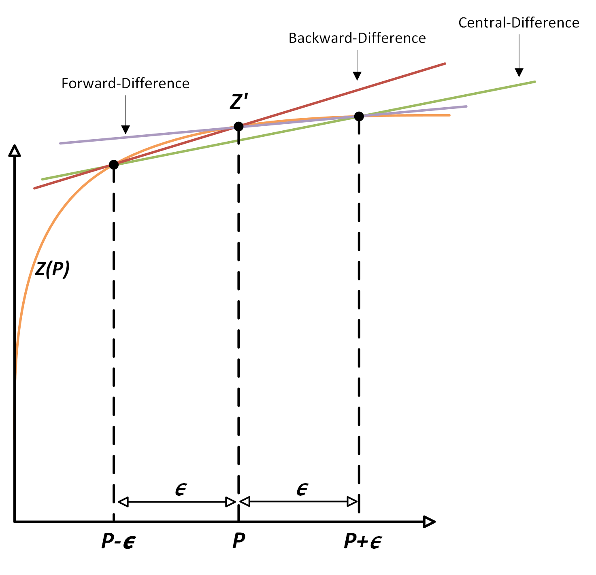
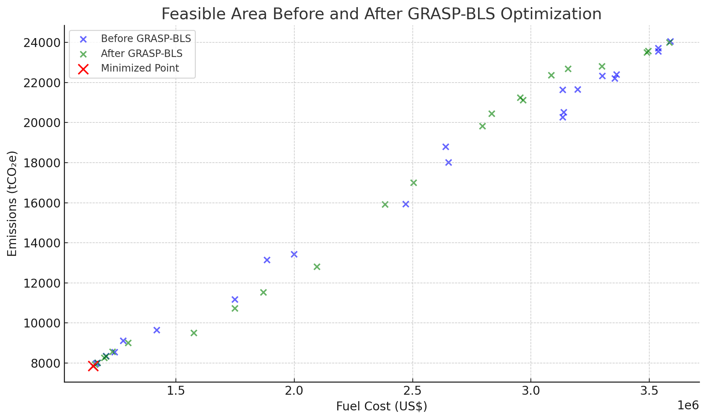
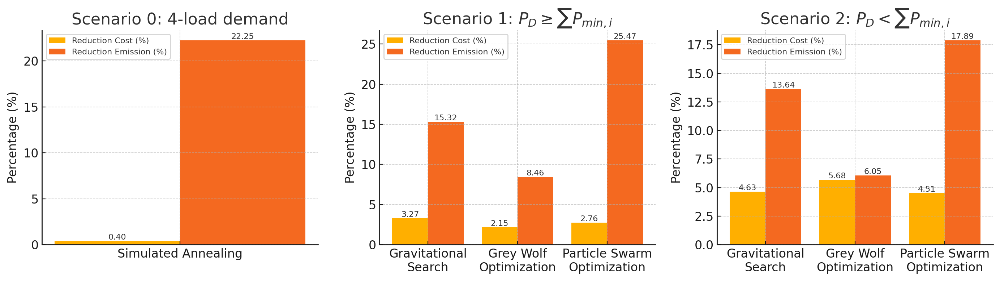

# GRASP-BLS

**A Greedy Adaptive and Backtracking Framework for Reducing Emission Costs in Generator Scheduling**

Raharjo, Jangkung · Ikhsan, Rifki R. N. · Yustika, Lindiasari M.  
*International Journal of Technology, 16(6), 2005–2024, 2025*  
[](https://doi.org/10.14716/ijtech.v16i6.7588)

GRASP + Backtracking Line Search hybrid for economic–emission dispatch (EED) with unit commitment.

## Abstract

The growing demand for efficient and environmentally sustainable power generation calls for advanced optimization methods to address the economic and emission dispatch (EED) problem. This study introduces a novel hybrid optimization approach, GRASP-BLS, which integrates GRASP for global solution space exploration with BLS for accurate local refinement. The synergy between metaheuristic randomness and gradient-based precision is the main contribution of this work, enabling GRASP-BLS to outperform conventional methods in complex, constrained power dispatch scenarios. In a 4-h test case, GRASP-BLS reduced generation costs by 0.4% and emissions by 22.25% compared with SEA. Extended evaluations over a 24-hour period under two scenarios—Scenario 1 (stable loads) and Scenario 2 (dynamic loads with unit commitment)—show that GRASP-BLS consistently yields superior performance. It achieves 5.64%–9.84% cost savings and 1.72%–4.91% emission reductions, outperforming GSA, GWO, and PSO. Despite slightly higher computation time, GRASP-BLS satisfies all operational constraints, including power balance, generation limits, ramp rates, and unit commitment feasibility. These findings highlight the novelty and practicality of GRASP-BLS as a robust, scalable, and adaptive framework for real-world power system optimization, particularly in environments requiring a balance between economic efficiency and environmental responsibility.


## Proposed method

GRASP-BLS couples a greedy randomised adaptive search procedure (GRASP) with a backtracking line search (BLS). GRASP builds a good starting dispatch from restricted candidate lists; BLS then refines it along the numerical gradient with an Armijo acceptance rule. Unit commitment is handled before dispatch by selecting a committed subset that can cover the demand. Two scenarios are reported: EED without unit commitment, and EED with unit commitment for low-load hours.

### Economic–emission objective

The two objectives are combined into one weighted scalar. Cost is converted to USD with the exchange rate, emissions are scaled to a comparable magnitude, and the balance violation is penalised:

$$Z(\mathbf{P})=w_1\frac{\sum_{i=1}^{N}\left(a_i+b_iP_i+c_iP_i^2\right)}{\varepsilon}+w_2\frac{\sum_{i=1}^{N}\left(d_i+e_iP_i+f_iP_i^2\right)}{10^{6}}+\lambda\left|\sum_{i=1}^{N}P_i-P_D\right|,$$

with $\varepsilon=14{,}385$ IDR/USD, $w_1+w_2=1$, and penalty factor $\lambda=10^{6}$. The weights set the trade-off: $w_1=1,w_2=0$ is pure economic dispatch, while larger $w_2$ buys emission reductions at a higher fuel cost.

### Notation

| Symbol | Meaning | Unit |
|---|---|---|
| $N$ | number of units | – |
| $P_i$ | output of unit $i$ | MW |
| $a_i,b_i,c_i$ | fuel-cost coefficients | IDR/h, IDR/MWh, IDR/MW²h |
| $d_i,e_i,f_i$ | emission coefficients | kg/h, kg/MWh, kg/MW²h |
| $w_1,w_2$ | cost and emission weights | – |
| $\varepsilon$ | IDR/USD exchange rate | IDR/USD |
| $\lambda$ | balance penalty factor | – |
| $P_D$ | demand | MW |
| $P_L$ | transmission loss | MW |
| $\alpha_{\mathrm{RCL}}$ | fraction kept in the restricted candidate list | – |
| $c_1,\beta_{\mathrm{BLS}}$ | Armijo coefficient and step-shrink factor | – |
| $\mathcal{A}$ | committed unit set | – |

### Constraints

$$\sum_iP_i=P_D+P_L,\qquad P_i^{\min}\le P_i\le P_i^{\max},\qquad -D_i\le P_i^{t}-P_i^{t-1}\le U_i.$$

The committed set must be able to cover the demand:

$$\mathcal{A}=\lbracei\mid u_i=1\rbrace,\qquad \sum_{i\in\mathcal{A}}P_i^{\max}\ge P_D,$$

where $u_i\in\lbrace0,1\rbrace$ is the on/off status. If no subset satisfies the inequality, all units are switched on as a fallback.

### Construction phase

For each unit, a restricted candidate list is drawn from the feasible interval:

$$\tau_i=\lbraceP_i\mid P_i^{\min}\le P_i\le P_i^{\max}\rbrace.$$

In the implementation, 100 equispaced candidates are shuffled, the best fraction $\alpha_{\mathrm{RCL}}=0.3$ is kept, and the value that minimises the partial objective is accepted:

$$P_i^{\text{best}}=\arg\min_{P_i\in\tau_i}Z\left([P_1,\dots,P_i,\dots,P_N]\right).$$

The restricted list prevents the greedy step from always taking the same extreme value and gives the multi-start loop its diversification.

### Backtracking line search

The gradient is evaluated by central differences with step $h=10^{-8}$:

$$g_j=\frac{Z(\mathbf{P}+h\mathbf{e}_j)-Z(\mathbf{P}-h\mathbf{e}_j)}{2h}.$$

Starting from step $s=1$, a trial point is accepted only if it satisfies the Armijo sufficient-decrease condition:

$$\mathbf{P}'=\mathbf{P}-s\mathbf{g},\qquad Z(\mathbf{P}')\le Z(\mathbf{P})-c_1s\Vert\mathbf{g}\Vert^2.$$

If the condition fails, the step is shrunk by $s\leftarrow\beta_{\mathrm{BLS}}s$ with $c_1=0.3$ and $\beta_{\mathrm{BLS}}=0.8$, down to $s\lt10^{-3}$. The outer loop repeats the gradient step while the iterate keeps changing. The Armijo rule guarantees a decrease in the objective and prevents a full Newton-like step from jumping over the minimum.

### Feasibility restoration

Ramp limits are enforced as

$$P_i^{t}\leftarrow\min\left(P_i^{t-1}+U_i,\quad\max\left(P_i^{t-1}-D_i,\quadP_i^{t}\right)\right),$$

then the residual balance error is spread equally over the units and clipped, iterating until $\left|\sum_iP_i-P_D\right|\le10^{-3}$ MW.

### Reported result

Across six 24-hour load levels the method reduces cost by 5.64%–9.84% and emissions by 1.72%–4.91% against GSA, PSO, GWO, WOA and other baselines.

## Contents

```
.gitignore
GRASP-BLS_EED-UC.ipynb
GRASP-BLS_EED.ipynb
figures/
  LCFD.png
  feasible_area.png
  results_summary.png
load_demand.ipynb
results/
  24-hours/
  24-hours (UC)/
  4-hours/
```

## Data

Input data is **not included**. Place files in `data/` (notebooks) or next to the `.m` script (MATLAB):

| File | Columns |
|---|---|
| `EED8u.xlsx` | Sheet1: `Unit`, `a`, `b`, `c`, `d`, `e`, `f`, `pmin`, `pmax`, `rampdown`, `rampup` |
| `EED_demand8u.xlsx` | Sheet1: `load`, `load2`, `load3` |


## Results

### Figures







### Result files

- [`results/24-hours/GRASP-BLS (EED).xlsx`](results/24-hours/GRASP-BLS (EED).xlsx)
- [`results/24-hours/GSA (EED).xlsx`](results/24-hours/GSA (EED).xlsx)
- [`results/24-hours/GWO (EED).xlsx`](results/24-hours/GWO (EED).xlsx)
- [`results/24-hours/PSO (EED).xlsx`](results/24-hours/PSO (EED).xlsx)
- [`results/24-hours (UC)/GPC (EED-UC).xlsx`](results/24-hours (UC)/GPC (EED-UC).xlsx)
- [`results/24-hours (UC)/GRASP-BLS (EED-UC).xlsx`](results/24-hours (UC)/GRASP-BLS (EED-UC).xlsx)
- [`results/24-hours (UC)/GSA (EED-UC).xlsx`](results/24-hours (UC)/GSA (EED-UC).xlsx)
- [`results/24-hours (UC)/GWO (EED-UC).xlsx`](results/24-hours (UC)/GWO (EED-UC).xlsx)
- [`results/24-hours (UC)/Jaya (EED-UC).xlsx`](results/24-hours (UC)/Jaya (EED-UC).xlsx)
- [`results/24-hours (UC)/PSO (EED-UC).xlsx`](results/24-hours (UC)/PSO (EED-UC).xlsx)
- [`results/24-hours (UC)/WOA (EED-UC).xlsx`](results/24-hours (UC)/WOA (EED-UC).xlsx)
- [`results/4-hours/GRASP-BLS (EED) [0.5,0.5].xlsx`](results/4-hours/GRASP-BLS (EED) [0.5,0.5].xlsx)
- [`results/4-hours/GRASP-BLS (EED) [1,0].xlsx`](results/4-hours/GRASP-BLS (EED) [1,0].xlsx)
- [`results/4-hours/GRASP-BLS (EED)[0,1].xlsx`](results/4-hours/GRASP-BLS (EED)[0,1].xlsx)
- [`results/4-hours/GRASP-BLS (EED)[0.25,0.75].xlsx`](results/4-hours/GRASP-BLS (EED)[0.25,0.75].xlsx)
- [`results/4-hours/GRASP-BLS (EED)[0.75,0.25].xlsx`](results/4-hours/GRASP-BLS (EED)[0.75,0.25].xlsx)


## Requirements

Python. Python notebooks: `numpy`, `pandas`, `scipy`, `matplotlib` (as imported). MATLAB scripts: R2021a+.

## Citation

```bibtex
@article{Raharjo_2025, title={A Greedy Adaptive and Backtracking Framework for Reducing Emission Costs in Generator Scheduling}, volume={16}, ISSN={2086-9614}, url={http://dx.doi.org/10.14716/ijtech.v16i6.7588}, DOI={10.14716/ijtech.v16i6.7588}, number={6}, journal={International Journal of Technology}, publisher={International Journal of Technology}, author={Raharjo, Jangkung and Ikhsan, Rifki R. N. and Yustika, Lindiasari M.}, year={2025}, month=Dec, pages={2005} }
```

## License

[](LICENSE)

Licensed under [CC BY 4.0](https://creativecommons.org/licenses/by/4.0/). **Attribution is required**: any use of this code, results, or figures, including in publications, must cite:

> Jangkung Raharjo; Rifki Rahman Nur Ikhsan; Lindiasari Martha Yustika (2025). A Greedy Adaptive and Backtracking Framework for Reducing Emission Costs in Generator Scheduling. *International Journal of Technology*. https://doi.org/10.14716/ijtech.v16i6.7588
